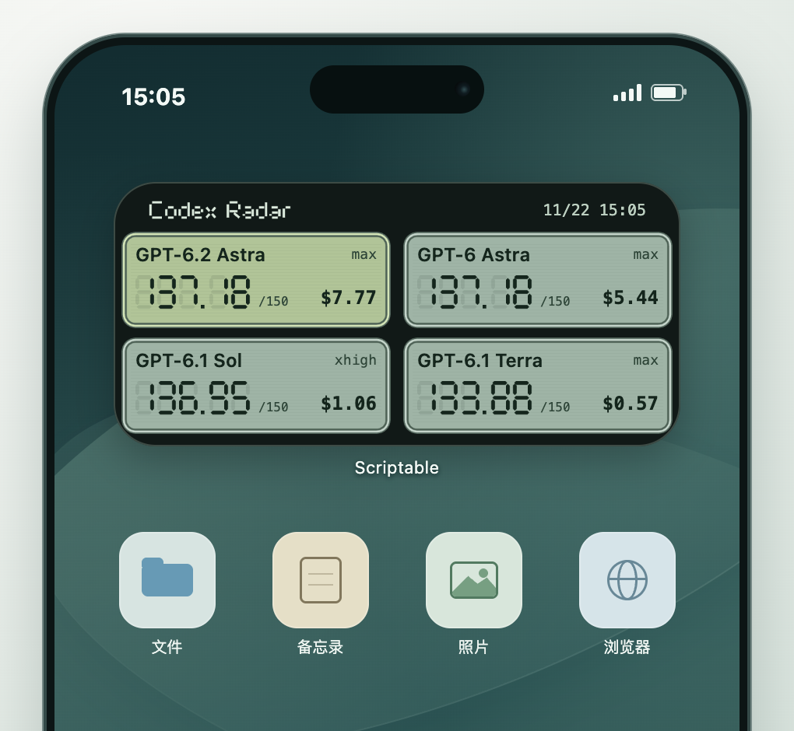

# Codex Radar iPhone 小组件

在 iPhone 主屏幕看 Codex 雷达榜单的前四个模型。每格显示该模型的最高分档位、智商分数和美元费用估算，右上角显示北京时间的取数时间。

[下载 Codex-Radar.scriptable](https://github.com/KilianThe14/codex-radar-scriptable/releases/latest/download/Codex-Radar.scriptable)



## 安装到 iPhone

1. 安装 Scriptable，并打开 App 一次。 [App Store](https://apps.apple.com/app/scriptable/id1405459188)
2. 用 iPhone 下载上面的 `Codex-Radar.scriptable`，存到「文件」App。也可以从 Mac 隔空投送，或放进 iCloud 云盘。
3. 在「文件」里长按安装包，选「共享」→ **Scriptable** → **Add to My Scripts**。分享菜单里的「更多」可以展开 App 列表。
4. 在 Scriptable 里运行 **Codex Radar**。看到液晶四格和右上角的时间，就完成了首次取数。
5. 回到主屏幕，长按空白处 →「编辑」→「添加小组件」，找到 Scriptable，选择**中号**。添加后长按这个组件 →「编辑小组件」→ **Script** → **Codex Radar**。 [Apple 小组件指南](https://support.apple.com/zh-cn/118610)

如果组件显示 `Configure widget to select the script to run`，回到第 5 步，在 **Script** 里选定脚本。

## 刷新和升级

每次取数成功后，组件把下一次可刷新的时间设为两小时后，实际执行时间由 iOS 调度。断网或接口异常时，组件保留上次成功的榜单和时间，并请求最早在 30 分钟后重试。 [Scriptable 刷新文档](https://docs.scriptable.app/listwidget/#refreshafterdate)

轻点组件会打开 Scriptable，重新取数并显示预览。主屏幕在 iOS 下一次重载组件时更新。要判断后台是否刷新过，看主屏幕右上角的时间是否自行变化。

升级时，从下载链接取得最新版，按安装步骤重新导入，再把现有组件的 **Script** 指向刚导入的脚本。

## 从源码构建

组件和缓存都在 iPhone 上运行。源码构建只需要 Node.js，用来重新生成 Scriptable 导入文件。

```bash
git clone https://github.com/KilianThe14/codex-radar-scriptable.git
cd codex-radar-widget
node scripts/build.mjs
```

构建完成后，把 `dist/Codex-Radar.scriptable` 按上面的步骤导入。修改样式、刷新间隔或时区时，编辑 `src/codex-radar.js`，再运行构建命令。

## 数据来源与许可

组件读取官网最近一轮已发布的成绩。同一模型取最高分档位，再从高到低选前四。费用使用官网提供的美元 API 等价估算。 [Codex 雷达榜单](https://codexradar.com/#overview) · [公开成绩 JSON](https://codexradar.com/data/codex-four-task-summary.json)

项目代码采用 [MIT 许可证](LICENSE)。
