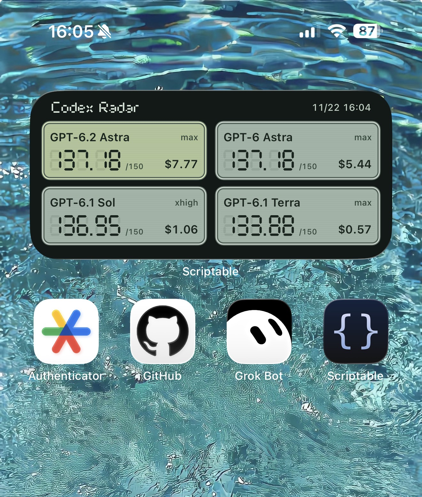

# Codex Radar iPhone 小组件

在 iPhone 主屏幕看 Codex 雷达榜单的前四个模型。每格显示该模型的最高分档位、智商分数和美元费用估算，右上角显示北京时间的取数时间。

[下载 Codex-Radar.scriptable](https://github.com/KilianThe14/codex-radar-scriptable/releases/latest/download/Codex-Radar.scriptable)



## 安装到 iPhone

### 1. 下载并导入脚本

1. 在 iPhone 上安装 **Scriptable**，打开 App 一次。 [在 App Store 获取 Scriptable](https://apps.apple.com/app/scriptable/id1405459188)
2. 用 iPhone 的 **Safari** 打开本页，轻点上方的安装包链接并下载。在「文件」App 的「浏览」中，进入「iCloud 云盘」或「我的 iPhone」下的「下载项」，找到 `Codex-Radar.scriptable`。 [Apple 下载项指南](https://support.apple.com/zh-cn/102440)
3. 在「文件」里长按安装包，选择「共享」→ **Scriptable** → **Add to My Scripts（添加到我的脚本）**。如果分享栏没看到 Scriptable，滑到末尾点「更多」。

如果仍找不到导入入口，可以在 Safari 打开下方的 JavaScript 源码并复制全文，然后在 Scriptable 点「+」新建脚本，粘贴后将脚本命名为 **Codex Radar**。 [打开 JavaScript 源码](https://raw.githubusercontent.com/KilianThe14/codex-radar-scriptable/main/src/codex-radar.js)

### 2. 在 Scriptable 里运行一次

打开 **Scriptable**，轻点脚本列表里的 **Codex Radar**。联网运行后，看到四格和右上角的时间，就完成了首次取数。点 **Close（关闭）** 退出预览，再回到 iPhone 主屏幕。

### 3. 在 iPhone 主屏幕添加并配置

1. 长按主屏幕空白处，点左上角的「编辑」→「添加小组件」。如果左上角显示「+」，点「+」进入小组件列表。
2. 搜索并选择 **Scriptable**。左右滑到**中号**（横向长方形），点「添加小组件」，再点「完成」。
3. **长按主屏幕上刚添加的 Scriptable 小组件**，点「编辑小组件」。在 **Script（脚本）** 里选 **Codex Radar**。**Parameter（参数）** 留空，**When Interacting（交互时）** 使用默认值。组件显示 `Configure widget to select the script to run` 时，就是在等待选择脚本。
4. 轻点配置面板外的空白处，回到主屏幕查看四格和右上角的取数时间。 [Apple 小组件指南](https://support.apple.com/zh-cn/guide/iphone/iphb8f1bf206/ios)

## 刷新和升级

组件由 iOS 自动刷新。每次取数成功后，最早可在两小时后再次刷新，具体时间由 iOS 调度。断网或接口异常时，组件保留上次成功的榜单和时间，并请求最早在 30 分钟后重试。 [Scriptable 刷新文档](https://docs.scriptable.app/listwidget/#refreshafterdate)

轻点组件会打开 Scriptable，重新取数并显示预览。主屏幕在 iOS 下一次重载组件时更新。要判断后台是否刷新过，看主屏幕右上角的时间是否自行变化。

升级时，从下载链接取得最新版并重新导入。在主屏幕长按已有组件，选择「编辑小组件」，将 **Script** 指向刚导入的脚本。

## 从源码构建

组件和缓存都在 iPhone 上运行。源码构建只需要 Node.js，用来重新生成 Scriptable 导入文件。

```bash
git clone https://github.com/KilianThe14/codex-radar-scriptable.git
cd codex-radar-scriptable
node scripts/build.mjs
```

构建完成后，把 `dist/Codex-Radar.scriptable` 按上面的步骤导入。修改样式、刷新间隔或时区时，编辑 `src/codex-radar.js`，再运行构建命令。

## 数据来源与许可

组件读取官网最近一轮已发布的成绩。同一模型取最高分档位，再从高到低选前四。费用使用官网提供的美元 API 等价估算。 [Codex 雷达榜单](https://codexradar.com/#overview) · [公开成绩 JSON](https://codexradar.com/data/codex-four-task-summary.json)

项目代码采用 [MIT 许可证](LICENSE)。
